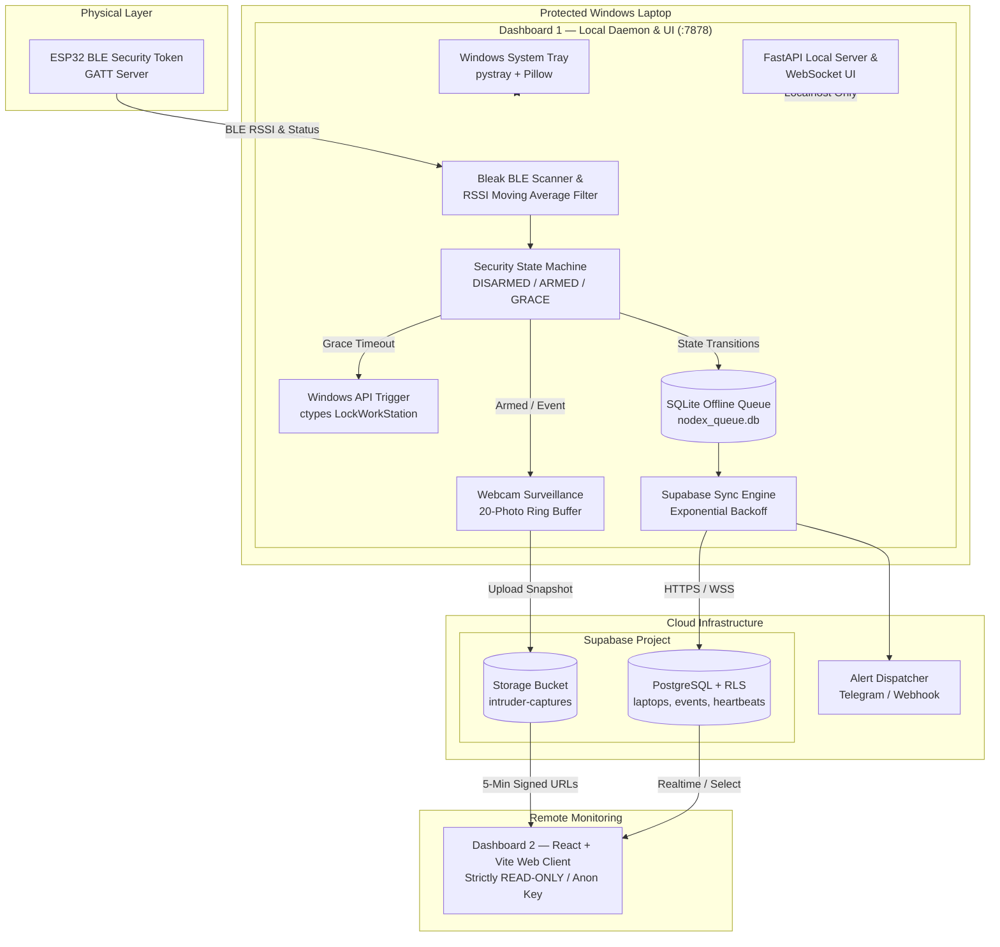
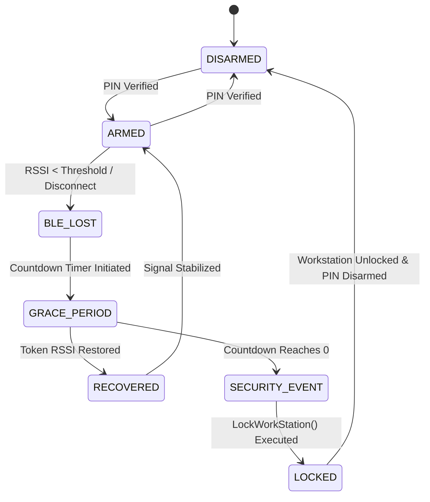

# NodeX 🛡️
### Automated Proximity Security & Cloud Telemetry for Windows

[](https://www.python.org/)
[](https://react.dev/)
[](https://vitejs.dev/)
[](https://tailwindcss.com/)
[](https://supabase.com/)
[](https://microsoft.com/windows)
[](https://www.bluetooth.com/)

**NodeX** is an automated physical proximity security and telemetry system for Windows laptops. Paired with a wearable **ESP32 BLE security token**, NodeX continuously monitors your physical presence. If you step away from your workstation or the Bluetooth signal is severed while armed, NodeX initiates a configurable grace countdown. If the token is not recovered in time, NodeX immediately locks Windows via the native API (`LockWorkStation`), captures webcam surveillance photographs, registers tamper-proof security audit logs, pushes emergency alerts, and syncs device telemetry to the cloud.

---

## 📑 Table of Contents

- [System Architecture](#-system-architecture)
- [Key Capabilities](#-key-capabilities)
- [Security State Machine](#-security-state-machine)
- [Repository Structure](#-repository-structure)
- [Dashboard 1: Local Windows Daemon](#-dashboard-1-local-windows-daemon-dashboard1)
  - [Features](#dashboard-1-features)
  - [Setup & Installation](#dashboard-1-setup--installation)
  - [Running the Daemon](#running-dashboard-1)
  - [REST & WebSocket API](#rest--websocket-api)
- [Dashboard 2: Cloud Telemetry Web App](#-dashboard-2-cloud-telemetry-web-app-dashboard2)
  - [Features & Security Guarantees](#dashboard-2-features--security-guarantees)
  - [Setup & Development](#dashboard-2-setup--development)
  - [Production Build & Deployment](#production-build--deployment)
- [ESP32 BLE Token & Protocol](#-esp32-ble-token--protocol)
- [Supabase Backend Setup](#-supabase-backend-setup)
- [Automated Testing](#-automated-testing)
- [Security & Threat Model](#-security--threat-model)
- [License](#-license)

---

## 🏛️ System Architecture

NodeX consists of three coordinated layers: an **ESP32 BLE physical token**, a **local Windows daemon (Dashboard 1)**, and a **cloud telemetry viewer (Dashboard 2)** backed by **Supabase**.



---

## ⚡ Key Capabilities

- **Automatic Proximity Locking**: Locks Windows instantly (`LockWorkStation`) when you walk away beyond the configurable RSSI threshold.
- **Debounced RSSI Smoothing**: Sliding-window moving average algorithm prevents false alarms from transient signal dips.
- **Offline-First Resilience**: All heartbeats, state transitions, and security events are buffered into a local SQLite queue (`nodex_queue.db`). Automatically flushes to Supabase upon network reconnection with exponential backoff.
- **Webcam Intruder Surveillance (20-Photo Ring Buffer)**: Captures periodic webcam snapshots while armed and an instant photograph upon a breach. Maintains a strict 20-photo circular buffer locally and in Supabase Storage (`intruder-captures`).
- **PIN-Protected Operations**: Arming, disarming, manual testing, and daemon shutdown require SHA-256 hashed PIN verification.
- **Windows System Tray & Native Mutex**: Runs seamlessly in the background with system tray status indicators, toast notifications, and single-instance mutex enforcement.
- **Zero-Trust Cloud Dashboard**: Dashboard 2 is an independent, 100% read-only React web app for remote auditing, device health monitoring, and intruder picture inspection without daemon dependencies.
- **Hardware Telemetry**: Collects battery level, AC charging status, CPU/RAM usage, network status, and opt-in location coordinates.

---

## 🔄 Security State Machine

The local monitor enforces a deterministic finite state machine with 6 operational states:



| State | Description | Actions Executed |
|---|---|---|
| `DISARMED` | System idle, proximity lock inactive. | Background telemetry heartbeats continue. |
| `ARMED` | Active monitoring of ESP32 BLE signal. | Webcam ring buffer captures every 30s; continuous RSSI smoothing. |
| `BLE_LOST` | Signal falls below threshold or drops out. | Debounce window activated to avoid spurious triggers. |
| `GRACE_PERIOD` | Visual/auditory countdown begins. | User can return to cancel; grace timer counts down. |
| `RECOVERED` | Token detected before countdown expiry. | Timer canceled; reverts smoothly to `ARMED`. |
| `SECURITY_EVENT` | Grace period expired without recovery. | Dispatches emergency alerts (Telegram/Webhook) & captures snapshot. |
| `LOCKED` | Security breach verified. | Calls native `LockWorkStation`, writes audit log, syncs queue. |

---

## 📂 Repository Structure

```
NodeX/
├── DashBoard1/                    # Local Windows Daemon & Device Dashboard
│   ├── nodex/                     # Core application package
│   │   ├── alerts/                # Telegram & webhook notification dispatchers
│   │   ├── ble/                   # Bleak BLE client, device scanner, RSSI smoother, mock mode
│   │   ├── collector/             # Hardware metrics, battery, network, opt-in location
│   │   ├── config/                # Settings manager, logging, hardware fingerprinting
│   │   ├── monitor/               # Security state machine, LockWorkStation trigger, grace timer
│   │   ├── sync/                  # SQLite offline queue, Supabase sync engine with retry backoff
│   │   └── ui/                    # FastAPI server, WebSockets, static dashboard assets, system tray
│   ├── scripts/
│   │   └── setup.py               # First-run setup wizard (Windows Credential Manager & auto-start)
│   ├── supabase/
│   │   └── schema.sql             # PostgreSQL schema with Row-Level Security (RLS) policies
│   ├── tests/                     # Pytest unit test suite (18 automated tests)
│   ├── .env.example               # Environment template for local daemon
│   ├── main.py                    # Application entry point with single-instance mutex
│   └── requirements.txt           # Python package dependencies
├── DashBoard2/                    # Cloud Telemetry Web Application (Read-Only)
│   ├── src/                       # React 18 application source code
│   │   ├── components/            # Reusable UI components (gauges, alerts, photo viewer, charts)
│   │   ├── lib/                   # Supabase client initialization & helpers
│   │   ├── pages/                 # Route views (Overview, Devices, Events, Captures, Settings)
│   │   ├── App.jsx                # App routing and layout structure
│   │   └── index.css              # Custom styling, dark mode & glassmorphism tokens
│   ├── supabase/
│   │   └── dashboard2_read.sql    # Idempotent SELECT-only RLS security policies
│   ├── .env.example               # Environment template for Vite frontend
│   ├── index.html                 # Single page application entry
│   ├── package.json               # Node.js dependencies and scripts
│   ├── tailwind.config.js         # Tailwind CSS design system tokens
│   └── vite.config.js             # Vite configuration
├── Tests/                         # Standalone diagnostic & experimentation scripts
│   ├── loc.py                     # IP geolocation test utility
│   ├── locations.txt              # Sample location outputs
│   ├── system.py                  # Hardware telemetry probe
│   ├── test.html                  # Mock browser interface test
│   └── test.py                    # Standalone BLE GATT characteristic reader
├── test.py                        # Root BLE scanner & GATT verification script
└── README.md                      # Unified project documentation
```

---

## 🖥️ Dashboard 1: Local Windows Daemon (`DashBoard1/`)

Dashboard 1 runs directly on the protected Windows workstation. It manages the BLE connection, runs the security state machine, invokes the Windows lock API, and hosts a local glassmorphic dashboard on `127.0.0.1:7878`.

### Dashboard 1 Features

- **Native Windows Lock Trigger**: Direct integration with Windows kernel via `ctypes.windll.user32.LockWorkStation`.
- **Sliding-Window RSSI Filter**: Calculates real-time moving averages and debounces erratic BLE packet drops.
- **Windows Credential Manager Integration**: Passwords and sensitive keys are stored in the secure Windows Credential Vault (`keyring`), never written to disk in plaintext.
- **Offline SQLite Event Queue**: Resilient offline store (`nodex_queue.db`) guarantees zero event loss even during complete network disconnects.
- **Local Glassmorphism Dashboard**: Real-time WebSocket connection to `http://127.0.0.1:7878` featuring live RSSI gauge, BLE scan modal, status badges, and settings management.
- **Webcam Capture Ring Buffer**: Automated 20-photo circular buffer locally (`DashBoard1/data/captures/`) and synced to Supabase Storage.
- **Mock Mode for Development**: `--mock-ble` flag enables full signal simulation without physical hardware.

### Dashboard 1 Setup & Installation

#### 1. Prerequisites
- **Operating System**: Windows 10 or Windows 11
- **Python**: Version 3.11 or higher
- **Bluetooth**: Bluetooth 4.0+ BLE compatible adapter

#### 2. Install Dependencies
```powershell
cd DashBoard1
python -m venv venv
.\venv\Scripts\Activate.ps1
pip install -r requirements.txt
```

#### 3. Configure Environment Variables
Copy `.env.example` to `.env`:
```powershell
cp .env.example .env
```
Fill in your Supabase configuration:
```env
SUPABASE_URL=https://your-project.supabase.co
SUPABASE_ANON_KEY=your-anon-public-key
NODEX_USER_EMAIL=user@example.com
```

#### 4. Run First-Time Setup Wizard
Execute the setup script to store your Supabase password securely in Windows Credential Manager, establish your management PIN, and optionally configure auto-start on Windows boot via Task Scheduler:
```powershell
python scripts/setup.py
```

### Running Dashboard 1

#### Standard Execution
```powershell
python main.py
```
- Starts background workers (BLE scanner, metrics collector, sync engine).
- Minimizes directly to the Windows system tray.
- Serves the local dashboard at `http://127.0.0.1:7878`.

#### Mock / Development Mode (No ESP32 Hardware Needed)
Simulates BLE discovery, fluctuating RSSI values, and proximity breach events:
```powershell
python main.py --mock-ble
```

#### CLI Options
| Flag | Description | Default |
|---|---|---|
| `--mock-ble` | Run with simulated BLE beacon and fluctuating RSSI | `False` |
| `--no-tray` | Run without system tray integration (useful for headless/CI) | `False` |
| `--port <PORT>` | Custom port for the local web server | `7878` |

### REST & WebSocket API

The local daemon binds strictly to `127.0.0.1` and exposes the following endpoints:

| Endpoint | Method | Description |
|---|---|---|
| `/` | `GET` | Serves the interactive device web dashboard |
| `/ws` | `WebSocket` | Real-time state updates, RSSI telemetry, and live status |
| `/api/status` | `GET` | Instant snapshot of current system state and metrics |
| `/api/arm` | `POST` | Arms monitor (`{"pin": "1234"}`) |
| `/api/disarm` | `POST` | Disarms monitor (`{"pin": "1234"}`) |
| `/api/test` | `POST` | Triggers a simulated security drill (does not lock workstation) |
| `/api/pair/scan` | `POST` | Initiates BLE scan for nearby ESP32 devices |
| `/api/pair/select` | `POST` | Pairs selected device (`{"address": "...", "name": "..."}`) |
| `/api/settings` | `GET/POST`| Reads or updates RSSI threshold, grace period, and preferences |
| `/api/sync/status` | `GET` | Reports SQLite offline queue depth and sync health |

---

## 🌐 Dashboard 2: Cloud Telemetry Web App (`DashBoard2/`)

Dashboard 2 is a lightweight, modern web application designed for remote viewing and administrative monitoring from any device (phone, tablet, remote desktop).

### Dashboard 2 Features & Security Guarantees

- **Strictly Read-Only Guarantee**: Executes zero mutations (`insert`, `update`, `upsert`, or `delete`). Connects solely via `select` queries and `createSignedUrl`.
- **Public Anon Key Authentication**: Uses only `VITE_SUPABASE_ANON_KEY` combined with Supabase Auth. The privileged `service_role` key is never bundled or needed.
- **Intruder Photo Viewer with Ephemeral Signed URLs**: Webcam captures residing in the private Supabase Storage bucket are signed on-demand with a 5-minute TTL.
- **Zero Daemon Dependency**: Operates independently even if the laptop is powered down, asleep, or stolen.
- **Glassmorphic UI**: Built with React 18, Vite, Tailwind CSS, Framer Motion, and Lucide React.
- **Zero External Charting Libraries**: Includes custom, responsive SVG/CSS bar and gauge charts for maximum speed and security.

### Dashboard 2 Setup & Development

#### 1. Install Dependencies
```bash
cd DashBoard2
npm install
```

#### 2. Configure Environment Variables
Copy `.env.example` to `.env`:
```bash
cp .env.example .env
```
Add your Supabase project parameters:
```env
VITE_SUPABASE_URL=https://your-project.supabase.co
VITE_SUPABASE_ANON_KEY=your-anon-public-key
```

#### 3. Start Local Development Server
```bash
npm run dev
```
Open `http://localhost:5173` in your browser.

### Production Build & Deployment

Build an optimized static distribution:
```bash
npm run build
```
The compiled assets will be in `DashBoard2/dist/`.

#### Deployment Targets
- **Vercel**: Set root directory to `DashBoard2`, framework preset `Vite`, and build command `npm run build`. Add `VITE_SUPABASE_URL` and `VITE_SUPABASE_ANON_KEY` to environment variables.
- **Netlify**: Deploy via CLI (`npx netlify deploy --prod --dir=dist`) or link your Git repository with publish directory set to `dist`.
- **GitHub Pages**: Set `base: '/NodeX/'` in `vite.config.js` and deploy `dist/` to your `gh-pages` branch.

---

## 📡 ESP32 BLE Token & Protocol

The NodeX security token runs on any standard ESP32 development board configured as a BLE GATT Server.

### Service & Characteristic UUIDs
- **Primary Service UUID**: `4fafc201-1fb5-459e-8fcc-c5c9c331914b`
- **Status Characteristic UUID**: `beb5483e-36e1-4688-b7f5-ea07361b26a8`

### BLE Verification Script
A verification script is provided at the repository root to discover and test communication with the physical ESP32 token:
```powershell
python test.py
```
This script scans for devices advertising as `NodeX`, connects, verifies the GATT services, reads the status characteristic value, and cleanly disconnects.

---

## 🗄️ Supabase Backend Setup

### 1. Database Tables & RLS Policies
Navigate to the **SQL Editor** in your Supabase dashboard and execute the script found in [DashBoard1/supabase/schema.sql](file:///a:/Coding/NodeX/DashBoard1/supabase/schema.sql).

This provisions:
- `laptops`: Hardware-fingerprinted device records (`fingerprint`, `name`, `battery_percent`, `security_mode`).
- `events`: Append-only security audit log (`event_type`, `state_before`, `state_after`, `rssi_smooth`, `image_url`).
- `heartbeats`: Periodic device status and telemetry reports (`battery_percent`, `charging`, `ble_connected`).
- `alerts`: Notification dispatch audit log (`alert_type`, `original_event`, `status`).

### 2. Storage Bucket for Webcam Captures
Create a private Supabase Storage bucket named `intruder-captures`.
Configure bucket policies to allow authenticated uploads from the daemon and signed read access for the cloud dashboard.

### 3. Read-Only Policies for Dashboard 2
To enforce that the web viewer user account has strictly `SELECT`-only privileges across all tables and storage, execute [DashBoard2/supabase/dashboard2_read.sql](file:///a:/Coding/NodeX/DashBoard2/supabase/dashboard2_read.sql) in your Supabase SQL Editor.

---

## 🧪 Automated Testing

### Pytest Unit Suite
The daemon includes a comprehensive Pytest suite in `DashBoard1/tests/`. To run the tests:
```powershell
cd DashBoard1
pytest tests -v
```

The 18 unit tests validate:
- **BLE RSSI Filter**: Sliding-window smoothing, outlier rejection, bad-reading debouncing, and cache reset.
- **Offline SQLite Queue**: Enqueueing, batch transactions, retry backoff, and sync confirmation.
- **State Machine Transitions**: `ARMED` → `BLE_LOST` → `GRACE_PERIOD` → `RECOVERED` or `LOCKED`.
- **Security Lock Prevention**: Verifies test mode suppresses actual OS locking calls.
- **Hardware Metrics Collector**: Validates CPU, memory, battery, and network parsing.
- **PIN Verification**: Validates SHA-256 salt and hashing logic.

---

## 🔒 Security & Threat Model

1. **Physical Theft & Snatch Defense**: If an attacker snatches the laptop, the sudden drop in the ESP32 BLE signal initiates immediate grace countdown and locks the workstation.
2. **Credential Hardening**: Sensitive credentials (Supabase master keys, passwords) are kept exclusively inside Windows Credential Manager (`keyring`), inaccessible to non-administrative local accounts.
3. **No Man-in-the-Middle on Cloud Client**: Dashboard 2 operates under a zero-mutation read-only policy using public Anon keys, preventing tampering even if the client-side session is intercepted.
4. **Local Daemon Isolation**: The FastAPI and WebSocket servers in Dashboard 1 bind exclusively to loopback interface `127.0.0.1`, rejecting all external inbound network traffic.
5. **Surveillance Privacy**: Webcam captures are saved in a rolling circular ring buffer of 20 images. Image 21 overwrites image 1 both locally and in cloud storage, preserving privacy and managing storage costs.

---

## 📄 License

This project is licensed under the MIT License. See the repository for details.
